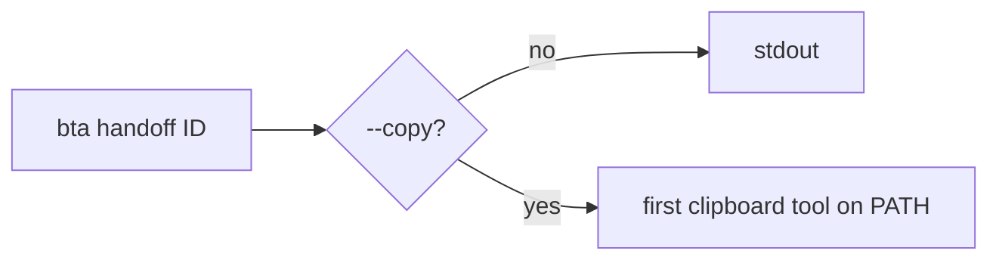

# Handoff and show

`handoff.py` renders sessions for people and for other agents. It's pure: it takes rows in and returns a string, with no LLM involved. The user's own words carry their intent better than any generated summary, so the pack is built around the intent spine.

## Building blocks

- `intent_spine(messages)`: user messages that aren't sidechains and have a non-empty `text` part.
- `files_touched(messages)`: unique `file_path` or `filePath` values from `tool_use` parts whose name, lowercased, is in `WRITE_TOOLS = {edit, write, multiedit, notebookedit}`.
- `render_transcript(messages)`: role headings, text, and `> [tool: name] target` lines. It leaves thinking out on purpose.

## Pack layout (`render_handoff`)

```markdown
# Context handoff: <title>
Source: <source> (<model>) · Project: <path>
Session: bta_… · start → end · N messages
Related sessions: bta_… (type — note)
## Goal                      first spine message, ≤600 chars
## What was asked, in order  each spine message, ≤200 chars
## Files touched             ≤20, then "…and N more"
## Where things stand        last assistant text, ≤1500 chars
## Full transcript           only with --full
```

The whole pack is truncated to `--max-chars` (default 8000) and ends with a marker saying so.

## Output targets



There's deliberately no option to write the pack to a file. A person pastes it with `--copy`, and an agent runs `bta handoff ID` and reads the output. Lode handovers are written by the agent, into `lode/tmp/`, from its own context, so `bta` doesn't write into a project's lode.

## Handoff auto-links

After any import that wrote messages, `link_handoffs` scans user messages (not sidechains) for `PACK_HEADER`. It reads the pack origin from the `Session:` line and links origin → new session with type `handoff`.

- Only `text` parts count. A `tool_result` that printed a pack (an agent ran `bta handoff`) never creates a link.
- Text before the pack is fine, such as "carry on from this:".
- It links only when the origin session is in the index. It's idempotent through `insert_link`.
- The pack format is the contract. Changing `PACK_HEADER` or the `Session: bta_… ·` line breaks detection for packs that are already pasted, so treat both as stable.

```python
SESSION_LINE = re.compile(r"^Session: (bta_[0-9a-f]{8}) ", re.M)
```

`bta show` prints the header and the numbered intent spine, or the full transcript with `--full`.

Related: [../terminology.md](../terminology.md), [../index/summary.md](../index/summary.md)
