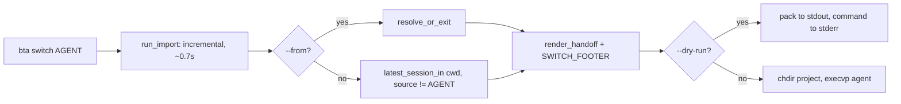

# Switching agents

`bta switch <claude|opencode>` continues a session in the other agent. It imports, picks the session, renders the pack, and replaces itself with the target agent (`os.execvp`). The agent starts in the session's project directory with the pack as its first message.

## Session choice

Without `--from`, it picks the most recent session whose `project` is the current directory and whose source isn't the target. You switch away from one agent, so `bta switch opencode` never picks an OpenCode session. Paths are prefiltered with `lower()` and confirmed with `os.path.samefile`, because macOS paths are case-insensitive (`~/Desktop` and `~/desktop` are the same folder).

## Launch commands

| Target | argv | First message |
|---|---|---|
| Claude Code | `claude <pack>` | sent straight away |
| OpenCode | `opencode --prompt <pack> <project>` | fills the input box in 2.0.x; you press Enter |

OpenCode 2.0 stopped auto-submitting `--prompt` ([opencode#51135](https://github.com/anomalyco/opencode/issues/51135)). `switch` tells you to press Enter. Don't work around it with `opencode run`, which isn't interactive.

## Contracts

- Exits 1 when no session matches, when the project directory doesn't exist on this machine, or when the agent isn't on `PATH`.
- `SWITCH_FOOTER` comes after the pack. The pack still starts with `PACK_HEADER`, so the next import links the new session back as a `handoff` (see [summary.md](summary.md#handoff-auto-links)).
- There's no `--json`. A successful run hands the terminal to another program. `--dry-run` covers scripting.
- No clipboard is needed, so switching works off macOS too.

Related: [summary.md](summary.md), [../sources/summary.md](../sources/summary.md)
