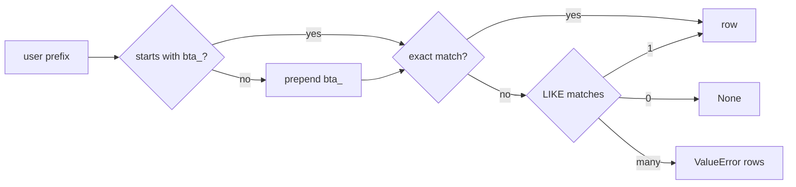

# Ids

```python
def session_id(source, source_id):   # bta_ + 8 hex chars
    return "bta_" + sha1(f"{source}:{source_id}").hexdigest()[:8]

def message_id(source, source_message_id):  # full 40-char sha1
    return sha1(f"{source}:{source_message_id}").hexdigest()
```

## Contracts

- Ids are deterministic, so `bta import --force` rebuilds the same ids. Links you made by hand survive a re-import, but not a deleted database.
- Changing the prefix or the hash input orphans every existing index and every link.
- `resolve_session(conn, prefix)` adds `bta_` when it's missing. It tries an exact match first, then `LIKE prefix%`, with `_` and `%` escaped. It returns `None` when nothing matches. When several rows match, it raises `ValueError(rows)`, and the CLI lists up to 10 of them.



## Lessons learned

The tests slice ids by prefix length (`sid[4:9]`), so they depend on the `bta_` prefix being 4 characters long.

Related: [summary.md](summary.md)
