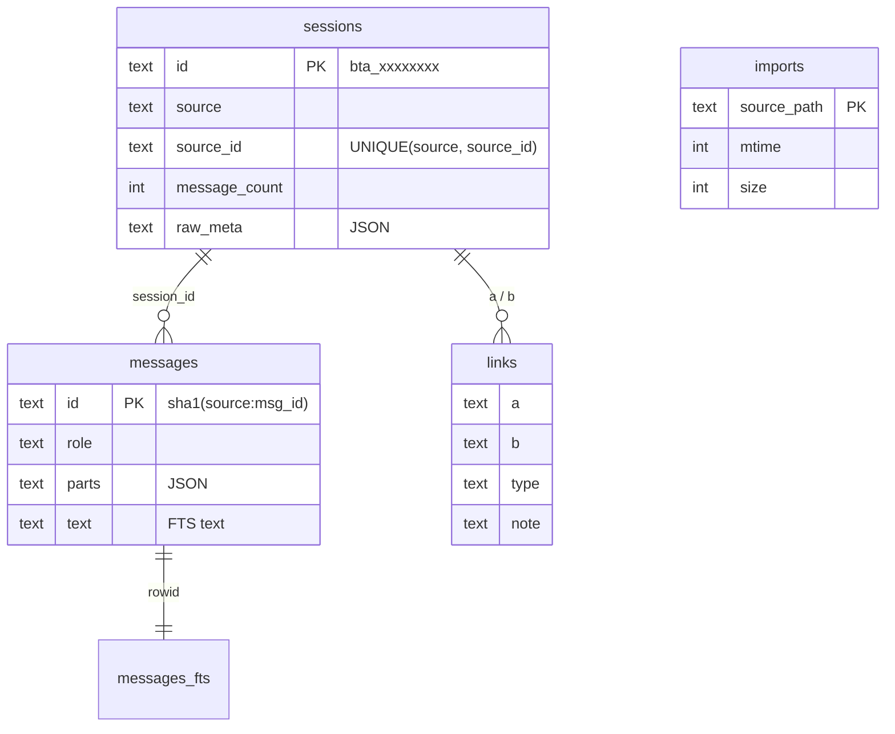

# Index (bta.db)

`db.py` owns the schema and every write helper. `connect()` opens `default_db_path()`: `$BTA_HOME/bta.db` when that's set, otherwise `$XDG_DATA_HOME/better-agent/bta.db` (falling back to `~/.local/share`). It applies the schema with `CREATE ... IF NOT EXISTS`. There are no migrations, so changing a column means a fresh index (`rm` it, then run `bta import`).



## Tables

- **sessions**: one row per source session. `raw_meta` holds per-source extras: Claude `version` and `project_slug`, or OpenCode `slug`, `agent`, and `cost`.
- **messages**: replaced wholesale on each re-import (`replace_messages` deletes, then inserts). `parts` holds the normalized JSON. `text` holds what gets indexed.
- **messages_fts**: an external-content FTS5 table over `messages.text`. `import_cmd` runs a full `rebuild` after any import that wrote messages. It doesn't update incrementally.
- **links**: primary key `(a, b, type)`. Reads treat links as undirected (`linked_sessions` matches either side), and `unlink` deletes both directions. `insert_link` skips a link whose type already joins the pair in either order, so `(b, a, type)` never duplicates `(a, b, type)`.
- **imports**: a change-detection cache keyed by `claude:<path>` or `opencode:db`.

## Search

`search` runs `MATCH` with the user's query as typed, so FTS5 syntax works. If that raises `sqlite3.OperationalError` (an FTS5 syntax error), it quotes every token and retries. Other errors aren't caught:

```python
quoted = " ".join('"' + t.replace('"', '""') + '"' for t in query.split())
```

Results rank by FTS `rank`, with `snippet(..., '[', ']', ' … ', 28)` for context.

Related: [ids.md](ids.md), [../sources/summary.md](../sources/summary.md)
