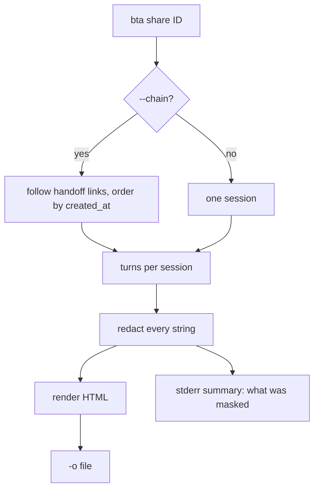

# Pitch: share a session with teammates

Status: shaped, not scheduled. Reader: teammates. User: you, sending one file.

## Problem

You want a teammate to see how you worked a problem with an LLM: what you asked, how you steered when it went sideways, and what the agent did in response. Today the options are bad:

- **A raw transcript is noise.** One session here is about 230k characters, and about 90% of it is tool input and output.
- **A screenshot or a pasted chat** loses the tool calls, which is where the agent's work actually shows.
- **Either one leaks.** The index holds 21 parts containing key-like strings, 425 with `…KEY=`/`…TOKEN=` assignments, and about 25,000 with a home path (measured 2026-11-18).

The story you want to tell is in your prompts, and the evidence is folded under each one.

## Appetite

Small batch: **2 days**. If it doesn't fit, cut scope (chain support goes first), not the redaction.

## Solution

```sh
bta share a1b2 -o approach.html          # one session
bta share a1b2 --chain -o approach.html  # follow handoff links across agents
bta share a1b2 --turns 3-8 -o fix.html   # just the part worth showing
```

`share` writes one self-contained HTML file: inline CSS, no JavaScript, and no network requests. You open it, check it, and attach it in Slack or email.



### Page, top to bottom

1. **Header:** the title, the agents and models used, the date range, and how many requests.
2. **Contents:** your prompts as a numbered list, each linking to its turn. Read alone, this shows your approach.
3. **One section per turn:**
   - **Your prompt**, in full and prominent.
   - **The agent's reply** that ended the turn, shown with `white-space: pre-wrap`.
   - **What the agent did**, folded. The summary is the existing `activity_line`. Expanding it shows each tool call with its input and output, which is already truncated to 2,000 characters in the index.
   - **Thinking**, folded, and only when there's text. OpenCode keeps text for about 80% of its reasoning parts, Claude Code for about 16%.
4. **Chain dividers** with `--chain`: "Switched to OpenCode · bta_9f8e…", wherever a `handoff` link joins two sessions.

Folding uses native `<details>`, so the page needs no JavaScript and reads fine printed:

```html
<section id="turn-3">
  <h2>3. Fix the opencode import tests</h2>
  <div class="reply">Both failures were the fixture …</div>
  <details><summary>Bash ×6 · Edit ×1</summary>
    <pre class="call">$ uv run pytest -q tests/test_opencode.py</pre>
    <pre class="out">2 failed, 12 passed …</pre>
  </details>
</section>
```

### Redaction

It runs on every string before rendering. It's deterministic and errs toward over-masking.

| Pattern | Becomes |
|---|---|
| Home directory (`/Users/<name>`, `/home/<name>`) | `~` |
| Key-like tokens (`sk-…`, `ghp_…`, `AKIA…`, `xox?-…`, private key blocks) | `[secret]` |
| `NAME_KEY=…`, `…TOKEN=…`, `…SECRET=…`, `…PASSWORD=…` | `NAME_KEY=[secret]` |
| Email addresses | `[email]` |
| Tool results from files named `*secret*`, `.env*`, or `*.pem` | dropped, leaving `[contents hidden]` |

After writing the file, `share` prints to stderr what it masked, such as `masked 3 secrets, 2 emails, 41 paths in 12 turns — review before sending`. That review is the safety net. The patterns won't catch everything, and the pitch doesn't pretend they do.

## Rabbit holes

- **Rendering markdown in replies.** That needs a new dependency or a hand-rolled parser. Use `pre-wrap` text and render code fences as `<pre>`, nothing more.
- **Perfect secret detection.** It isn't achievable. Mask the known shapes, report the counts, and rely on your review.
- **Showing every tool call expanded.** Big outputs make the page unreadable. Keep them folded, and keep the 2,000-character cap from the index.
- **Turn boundaries across agents.** `turns()` already handles both Claude Code and OpenCode. Reuse it, don't re-derive it.

## No-gos

- Hosting, uploading, or links. It produces a file, and you choose where it goes.
- LLM summaries or rewriting. The page shows what happened, deterministically, like the rest of `bta`.
- Annotations or an editing UI. If you need to explain a turn, write it in the Slack message.
- A Markdown or PDF export. Add it if teammates ask.
- Merging sessions other than through `handoff` links.

## Done means

You run one command on a real session from this repo, open the file, read the contents list, and would send it to a teammate without editing it first. The stderr summary makes you confident nothing private is inside.

## Fits with

- `turns()` and `activity_line()` in [../handoff/summary.md](../handoff/summary.md) provide the turn structure.
- `handoff` links from [../handoff/switch.md](../handoff/switch.md) make `--chain` possible.
- [../practices.md](../practices.md#cli-design): `-o/--output` is clig's standard name, results go to stdout or the file, and the masking summary goes to stderr.
