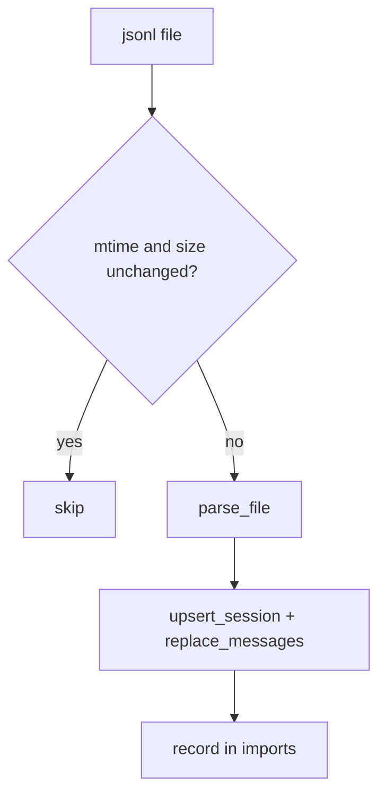

# Claude Code source

`sources/claude.py` reads `~/.claude/projects/*/*.jsonl`. Each file is one session, with one JSON event per line.

## Parsing rules

- It keeps only `user`, `assistant`, and `summary` events. Other event types (`api-request`, `attachment`, `permission-mode`, and so on) change between versions and are ignored.
- It skips lines that aren't valid JSON, which tolerates the half-written last line of a live session.
- Session fields come from the events: `sessionId` (falling back to the file stem), the last `cwd` (project), the last `gitBranch`, `version`, and the last assistant `message.model`.
- The title is the first `summary` event. Failing that, it's the first non-sidechain user text, collapsed and cut to 80 characters. Failing that, it's the file stem.
- The message id is `uuid`, or `line-<n>` when that's missing. `parentUuid` becomes `parent_id`, and `isSidechain` marks subagent messages.
- Tool results arrive as `user` events with `tool_result` blocks. They're stored with role `user` but have no `text` part, which is how the intent spine leaves them out.

```json
{"type":"user","sessionId":"abc","uuid":"u1","cwd":"/p","gitBranch":"main",
 "timestamp":"2026-11-17T21:49:00Z","message":{"content":"fix the import"}}
```

## Incremental import

The `imports` row is keyed `claude:<absolute path>` and stores `mtime` and `size`. A file is re-parsed when either changes, or when you pass `--force`. Re-parsing replaces all of that session's messages.



Related: [summary.md](summary.md), [opencode.md](opencode.md)
