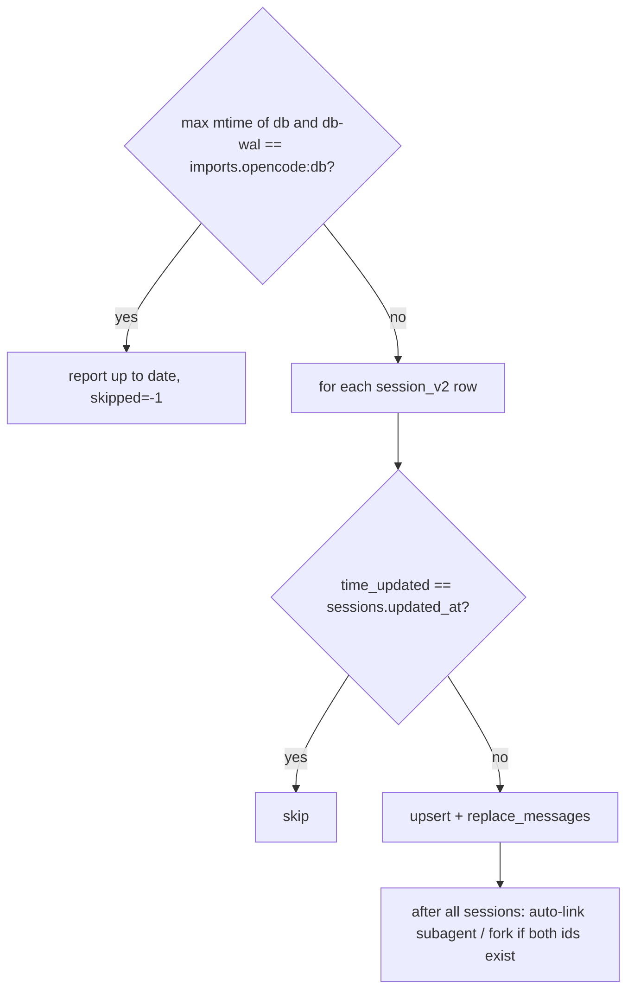

# OpenCode source

`sources/opencode.py` reads `~/.local/share/opencode/opencode.db` (OpenCode v2, a drizzle-managed SQLite database), opened read-only. It doesn't import the older pre-v2 `storage/` file layout.

## Tables read

- **session_v2**: session metadata. `directory` becomes the project, and `title` (or `slug`) becomes the title. `parent_id` and `fork_session_id` drive auto-links. `slug`, `agent`, and `cost` go into `raw_meta`.
- **session_message**: the canonical message table. `type` is the role (only `user` and `assistant` are imported), and rows are ordered by `seq`.
  - User rows carry `data.text`.
  - Assistant rows carry their parts inline in `data.content`.
  - Rows with neither are dual-era rows, whose parts come from the legacy `part` table.
- **part**: legacy storage, used only as that fallback. The old `message` table isn't read.

Part mapping: `text` → `text`, `reasoning` → `thinking`, and `tool` → `tool_use` with `output` and `status`. Other part types (`step-start`, `step-finish`, `patch`, `file`, `compaction`) are dropped.

The model is `data.model.providerID/id` in v2, falling back to the flat `providerID/modelID` shape.

## Incremental import

The WAL file's mtime is included because OpenCode writes through WAL, so the main db file's mtime lags behind.

## Auto-links

- A child session with `parent_id` gets a link of type `subagent` to its parent.
- A session with `fork_session_id` gets a link of type `fork` to the session it forked from.

A link is created only when both sessions are in the index. `INSERT OR IGNORE` keeps it idempotent.

## Lessons learned

OpenCode stopped writing the legacy `message` and `part` tables partway through v2. Reading only those tables silently returns empty sessions. Keep the test fixture schema in `tests/test_opencode.py` matching the real one.

Related: [summary.md](summary.md), [claude-code.md](claude-code.md)
