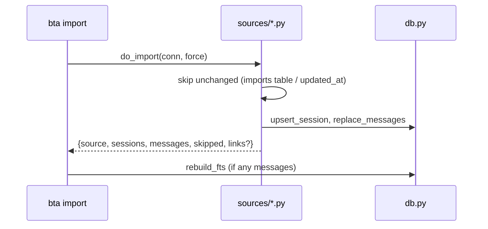

# Sources

Each source module turns one tool's storage into `SourceSession` plus a list of `SourceMessage` (`models.py`), and exposes `do_import(conn, force)`. `bta import` runs both sources, or one when given `--source claude|opencode`, then rebuilds FTS.

## Shared normalization

| Part type | Stored | Indexed for search |
|---|---|---|
| `text` | full text | full text |
| `thinking` | full text | no |
| `tool_use` | name and input (OpenCode also keeps output, truncated to 2000) | `[tool: name] target`, plus OpenCode output truncated to 500 |
| `tool_result` (Claude) | text truncated to 2000 | text truncated to 500 |

`target` is the first of `file_path`/`filePath`, `command`, `pattern`, or `path`, truncated to 200 characters.

| | Claude Code | OpenCode |
|---|---|---|
| Detail | [claude-code.md](claude-code.md) | [opencode.md](opencode.md) |
| Unit of change | one `.jsonl` file | the whole db, then each session |
| Change check | file mtime and size | db/WAL mtime, then `time_updated` |
| Subagents | sidechain messages in the same session | separate sessions plus auto-links |
| Branch | `gitBranch` | not available |

Related: [../index/summary.md](../index/summary.md), [../practices.md](../practices.md)
