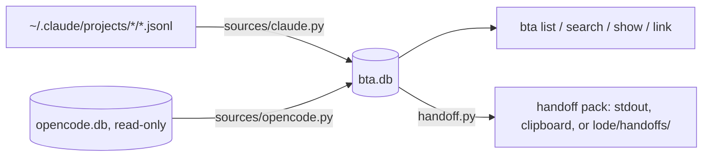

# better-agent

better-agent (`bta`) is a local CLI that copies coding-agent sessions from Claude Code and OpenCode into one SQLite database at `~/.better-agent/bta.db`. The database has FTS5 full-text search. Users list, search, and read sessions, link related ones, and render a handoff pack (a paste-ready markdown summary) to carry work from one agent to another. The tools' own files stay the source of truth: `bta` only reads them, and you can rebuild the index at any time with `bta import --force`. Nothing calls an LLM. Every output is a deterministic function of the imported data. It's a Python 3.11+ package managed with uv, whose only runtime dependencies are typer and rich.

- How data is stored: [index/summary.md](index/summary.md)
- How each tool is read: [sources/summary.md](sources/summary.md)
- How handoffs are built: [handoff/summary.md](handoff/summary.md)
